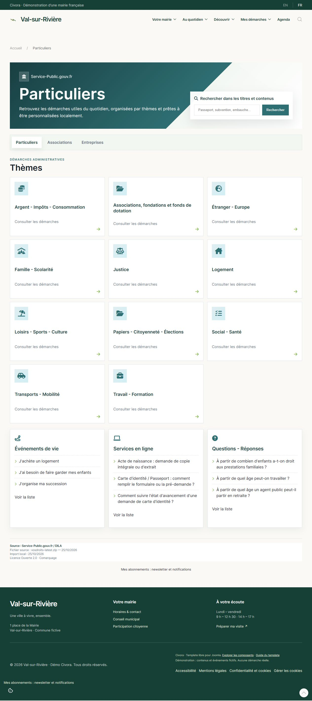
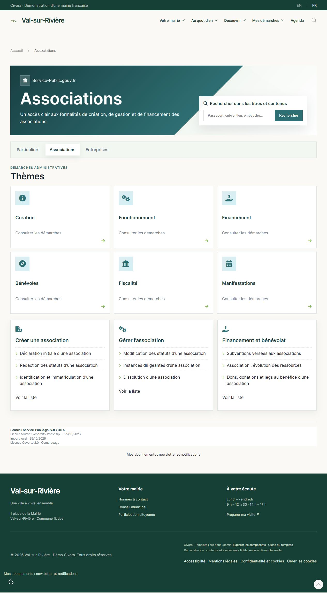
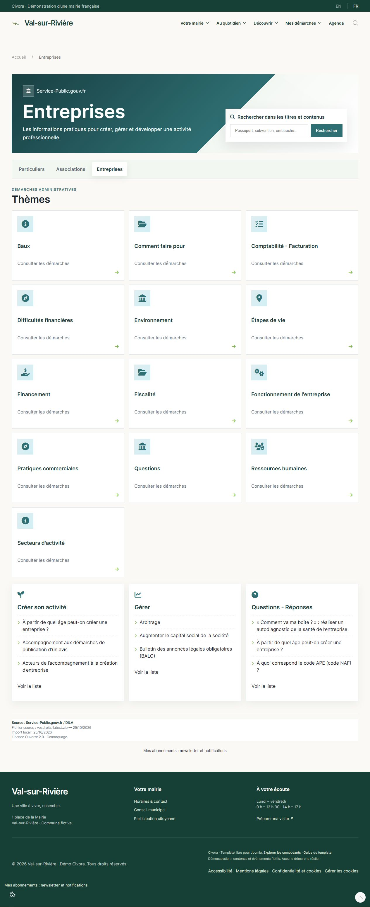
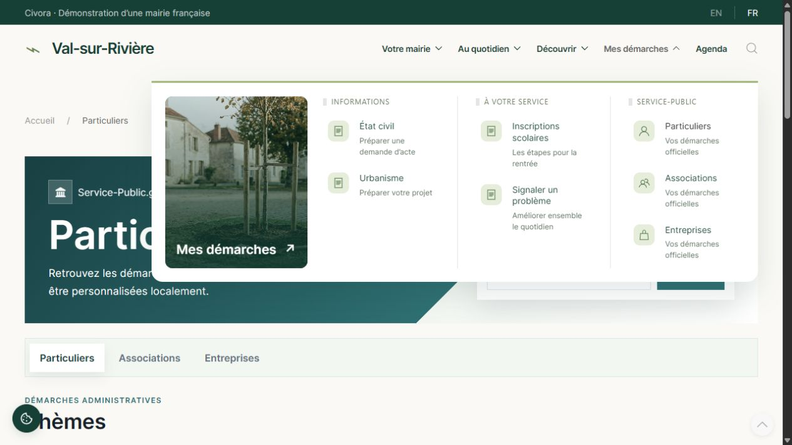

# Captures / Screenshots

Captures réelles de Comarquage 1.0.2 sur Étoile, avec le thème municipal Civora. Val-sur-Rivière est une commune fictive. Le thème Civora et le contenu du site de démonstration ne sont pas inclus dans le package Comarquage.

Actual Comarquage 1.0.2 screenshots using the Civora municipal template. The template and demo website are not included. Official administrative data remains in French.

## Particuliers

Les démarches du quotidien dans un site municipal.

## Associations

Création, gestion, financement et bénévolat.

## Entreprises

Création et fonctionnement de l’entreprise.

## Menus Joomla

Les trois publics accessibles depuis le menu municipal.

## Test du code INSEE — Béthune 62119

Validation distincte sur Joomla Cassiopeia : 46 contacts officiels chargés pour Béthune, avec sélection selon le public. Le code INSEE n’est pas un code postal. / Separate municipality test on Joomla Cassiopeia.

