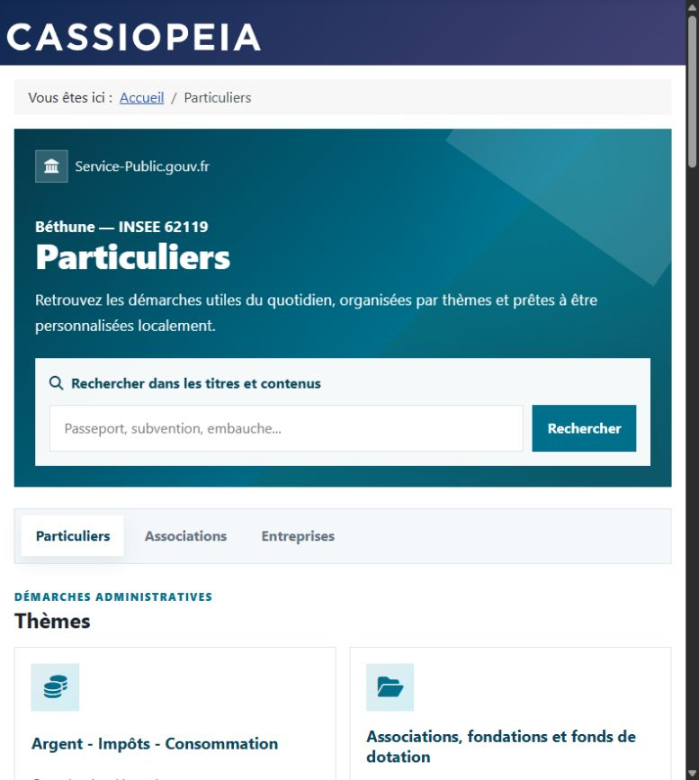
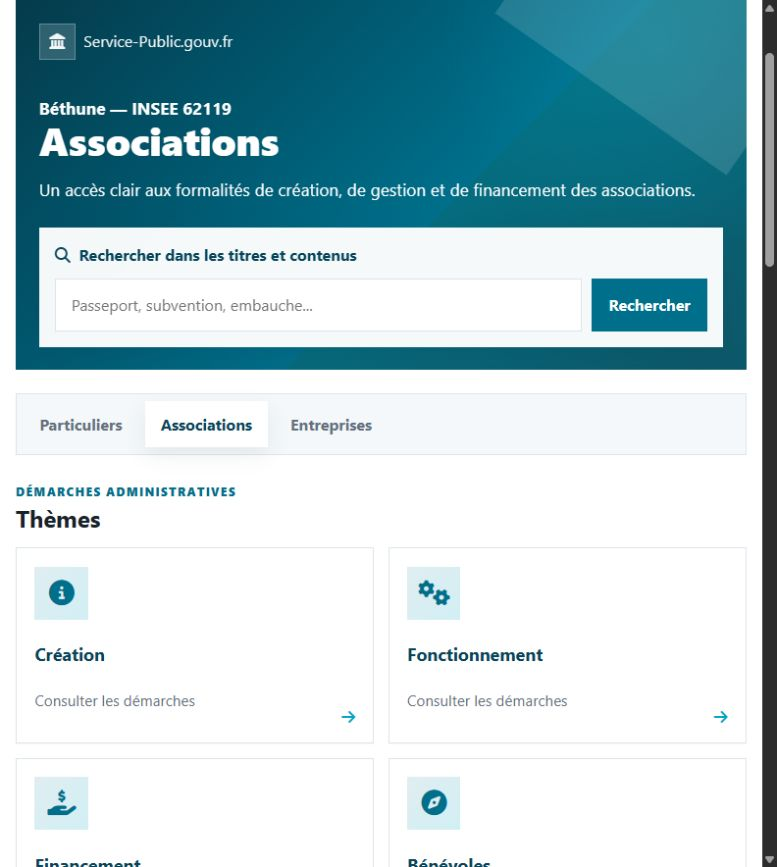
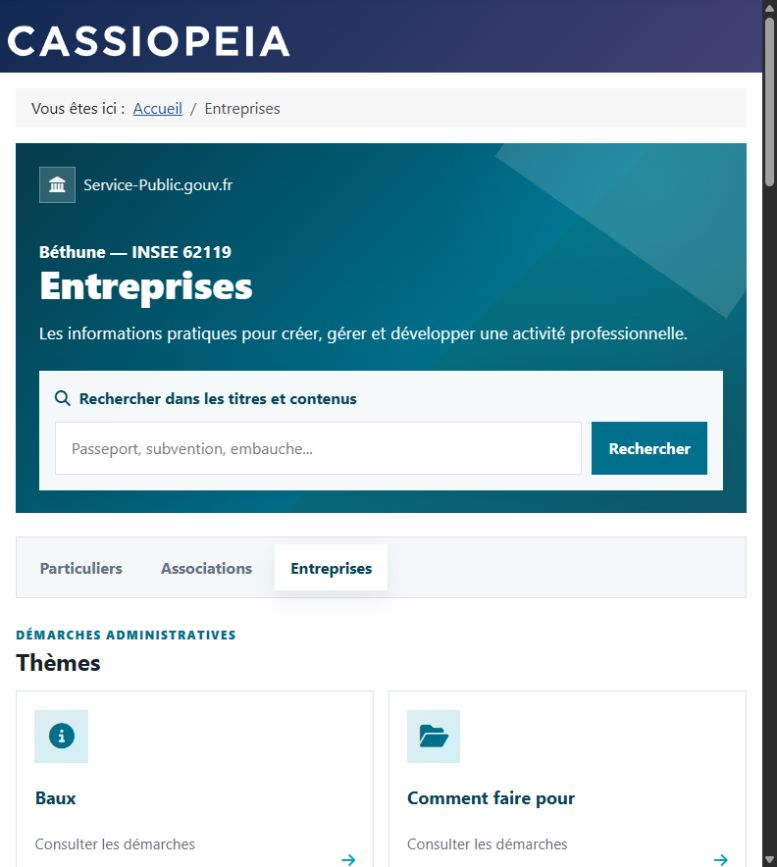
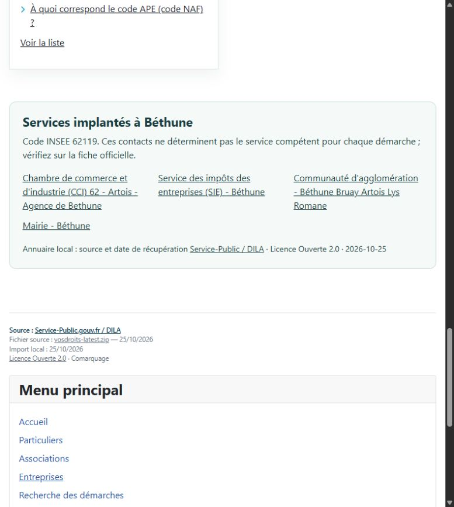
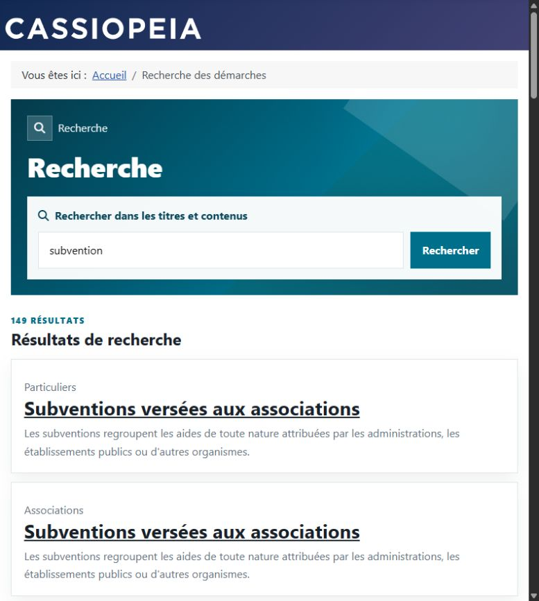

# Captures / screenshots

Captures du site local de démonstration, Joomla Cassiopeia, avec Béthune (code INSEE 62119). Données DILA importées le 25 octobre 2026. Les liens et le module Menu sont gérés par Joomla.

Local Joomla demo, with separate Individuals, Associations and Businesses sections and optional municipality context.

## Particuliers — Béthune, INSEE 62119

## Associations — création, gestion et financement

## Entreprises — démarches professionnelles

## Services de Béthune et quatre liens de menu

## Recherche dans les trois univers

